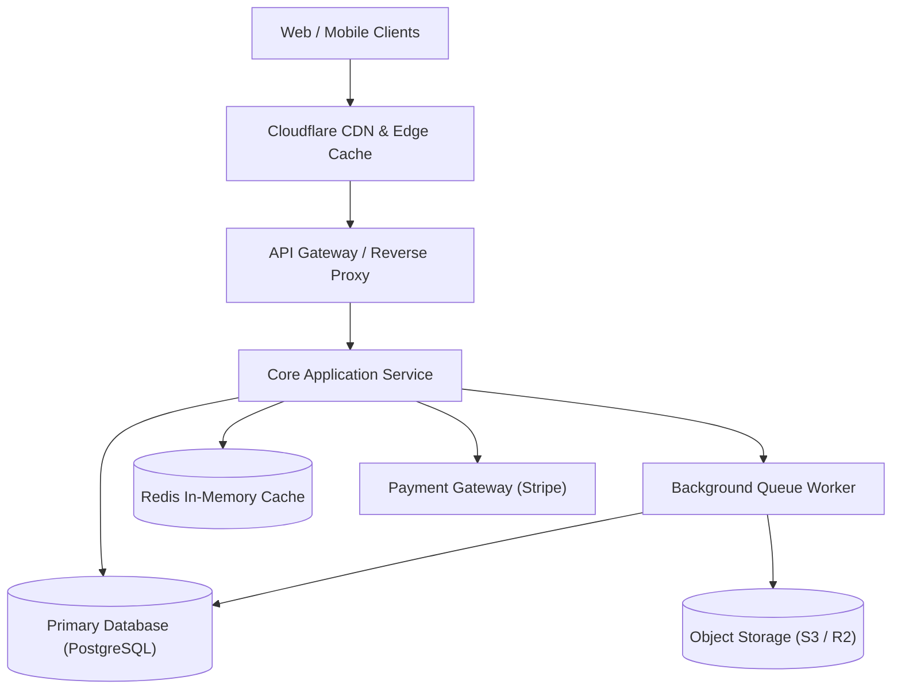
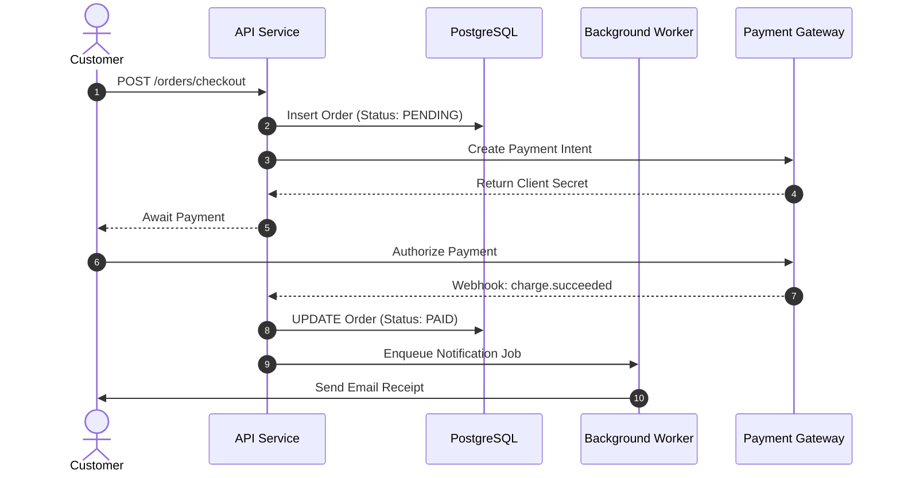

# System Architecture & Component Map

This document outlines the high-level architecture, module boundaries, external integrations, and core data flow paths.

---

## 1. High-Level Component Topology

---

## 2. Layer Responsibilities

| Layer | Technology | Primary Responsibilities |
| :--- | :--- | :--- |
| **Edge & Routing** | Cloudflare / Nginx | SSL termination, DDoS protection, static asset caching |
| **API Gateway** | Express / Hono / FastAPI | Rate limiting, JWT verification, request validation |
| **Core Service** | Application Code | Domain business logic, transaction coordination |
| **Worker Queue** | BullMQ / Celery | Asynchronous jobs, email dispatches, PDF generation |
| **Persistence** | PostgreSQL 16 | Relational data, ACID transactions, audit logs |
| **In-Memory** | Redis | Session state, rate limiter counters, transient caches |

---

## 3. Core Data Flow: Order Placement & Settlement

---

## 4. Architectural Invariants
* **Zero Synchronous External Calls in DB Transactions:** Never perform third-party HTTP requests (e.g. Stripe, SendGrid) inside an open database transaction block. Always commit or stage via outbox pattern first.
* **Idempotent Webhooks:** All webhook endpoints must record incoming event IDs in an `idempotency_keys` table to prevent duplicate processing during network retries.
