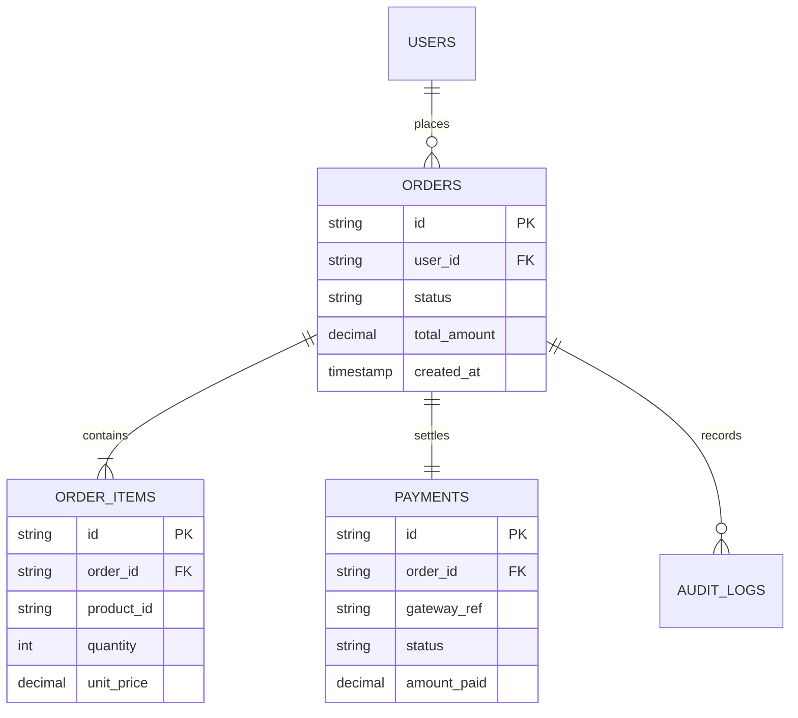
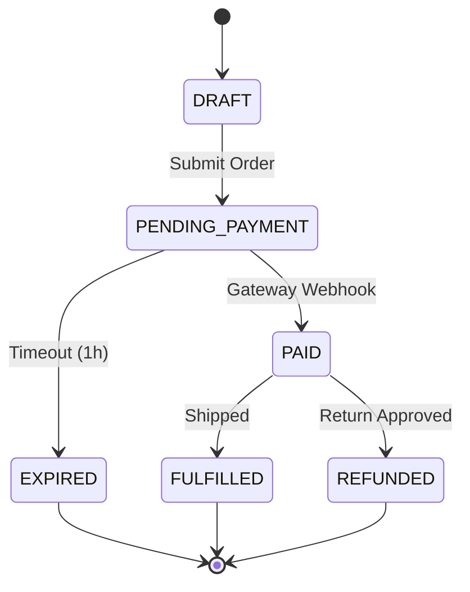

# Domain Entity & Database Relationships

This document maps core database tables, foreign key constraints, state transitions, and distributed synchronization rules.

---

## 1. Core Entity Diagram



---

## 2. Multi-Table Synchronization Rules

Whenever updating financial or critical workflow records, the following interrelated tables **must be updated synchronously within the same transaction**:

* **Order Total & Payment Split:**
    * When modifying `ORDERS.total_amount`, always verify `PAYMENTS.amount_paid` matches.
    * A discrepancy between `ORDERS.total_amount` and `SUM(ORDER_ITEMS.quantity * unit_price)` indicates a calculation corruption.

* **Audit Logging:**
    * Every manual DML modification against `ORDERS` or `PAYMENTS` must produce a corresponding record in `AUDIT_LOGS`.

---

## 3. Key Status Lifecycles



---

## 4. Useful Diagnostic Queries

### Identify Unsettled Orders Past SLA
```sql
SELECT o.id, o.user_id, o.total_amount, o.created_at, p.status AS payment_status
FROM orders o
LEFT JOIN payments p ON p.order_id = o.id
WHERE o.status = 'PENDING_PAYMENT'
  AND o.created_at < NOW() - INTERVAL '24 hours';
```

### Detect Amount Mismatches Between Order and Items
```sql
SELECT o.id, o.total_amount, SUM(i.quantity * i.unit_price) AS items_sum
FROM orders o
JOIN order_items i ON i.order_id = o.id
GROUP BY o.id, o.total_amount
HAVING o.total_amount <> SUM(i.quantity * i.unit_price);
```
